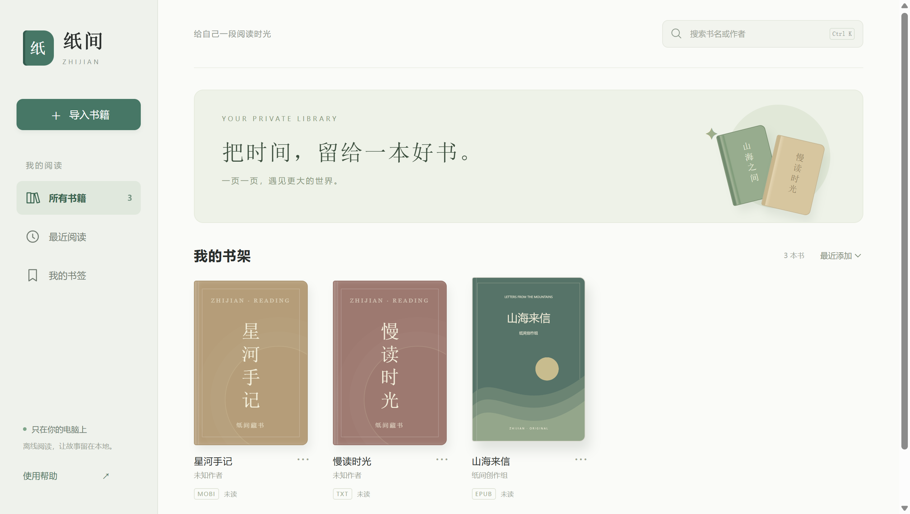
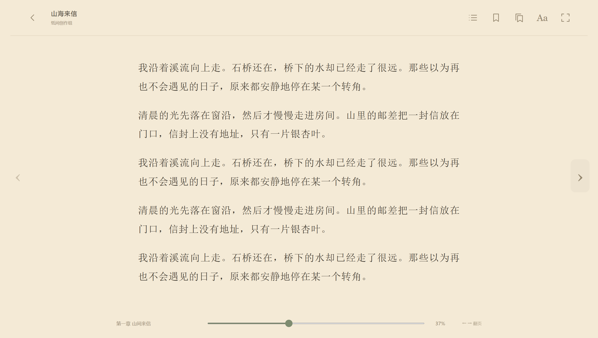

# 纸间 · Zhijian

一个安静、离线、中文优先的 Windows 电子书阅读器。浅色封面书架，默认暖纸页面，让阅读慢下来。

支持真正的 **TXT、EPUB、无 DRM MOBI** 阅读，不需要账户，也不会上传书籍。





## 使用

下载 Windows x64 便携包后，解压整个文件夹，双击 **纸间.exe**。无需安装 Node.js。程序旁的 DLL、resources、locales 等文件需要保留。

将书籍拖入窗口，或点击“导入书籍”。空书架可以加载三本原创示例，分别演示三种真实格式。导入建立本地副本，原文件不变；相同内容自动去重。

功能包括目录导航、左右翻页或上下滚动、宋体与黑体、字号和行距、浅色/暖纸/深色、书签、专注模式、书名与作者搜索、最近阅读，以及退出重启后的精确位置恢复。

书籍、设置、进度与书签保存在程序旁的 `纸间数据/`。备份或迁移时复制整个文件夹。应用不修改全局文件关联。

| 快捷键 | 功能 |
|---|---|
| ← / →、PageUp / PageDown | 翻页 |
| 空格 | 下一页 |
| F | 专注模式 |
| Esc | 关闭面板、退出专注、返回书架 |
| Ctrl K | 书架搜索 |

## 格式范围

- TXT：UTF-8、UTF-16 BOM、GB18030/GBK 自动处理；书籍菜单可手动选择 Big5 等编码。中文章节自动识别，长章节分段保留全部正文。
- EPUB：EPUB 2/3 解析、元数据、封面、目录和正文。已验证原创 EPUB 3；不同出版物的复杂排版仍可能有差异。
- MOBI：Foliate 的 MOBI 6、PalmDOC、HUFF-CDIC 与 KF8 解析链路；已验证未压缩和 PalmDOC 压缩中文 MOBI 6。KF8/AZW3 和 HUFF-CDIC 已接入，尚无样本覆盖。
- DRM 文件明确拒绝，不提供解密或绕过。暂不支持 KFX、PDF、扫描书与书内交互脚本。

单本上限 100 MB，TXT 上限 20 MB。EPUB 解压总量上限 128 MB、单条目 16 MB、8000 条目，并检查压缩比和路径；MOBI 解压文字上限 64 MB。超限会提示。

## 本地开发

需要 Windows x64、Node.js 22 或更新版本。

```sh
npm install
npm start
```

```sh
npm test       # 生成原创样本并运行 Windows Electron 端到端测试
npm run pack   # 打包 release/纸间-1.0.0-Windows-x64/
```

`ELECTRON_DIST` 可指定已有的 Electron 运行时目录；`ELECTRON_PATH` 可让测试直接验证打包后的 exe。构建没有上传或发布步骤。

测试覆盖真实三格式导入、中文长章节、目录跳转、翻页与滚动、字体主题、书签、重启恢复、重复导入、中文编码、损坏文件、DRM 和恶意 EPUB。所有样本为本项目原创，测试不读取个人书库。`tests/fixtures` 由脚本生成，测试产生的书库和阅读记录已从版本控制排除。

## 安全设计

Electron 开启 `contextIsolation`、进程沙箱和 `webSecurity`，禁用 Node 集成，严格验证 IPC 来源。自定义协议只提供应用静态资源，不暴露任意本地文件。网络请求、弹窗、导航与权限请求被阻止。

书籍章节清除脚本、嵌套框架、对象、表单和事件处理器；在不允许脚本的 iframe 中展示，并施加章节 CSP。EPUB 不解压到文件系统，检查重复/遍历路径、体积、压缩比和解压校验。MOBI 增加了解压和递归边界。这些是防护措施，不代表经过独立安全审计。

## 许可证与致谢

应用源码采用 [MIT](LICENSE)。

- [Electron](https://github.com/electron/electron)：MIT，包含 Chromium 第三方许可证。
- [Foliate JS](https://github.com/johnfactotum/foliate-js)：MIT，固定提交 `78914aef4466eb960965702401634c2cb348e9b1`。本地修改移除书籍 iframe 的脚本权限，并增加解压边界和布局生命周期保护。
- [zip.js](https://github.com/gildas-lormeau/zip.js)：BSD-3-Clause。
- [fflate](https://github.com/101arrowz/fflate)：MIT。

这些许可证兼容本项目的 MIT 分发；原始许可证和声明保留于 `vendor/foliate-js/LICENSE`、`third-party/` 和便携运行时目录。原创示例允许自由阅读、复制与分发。
